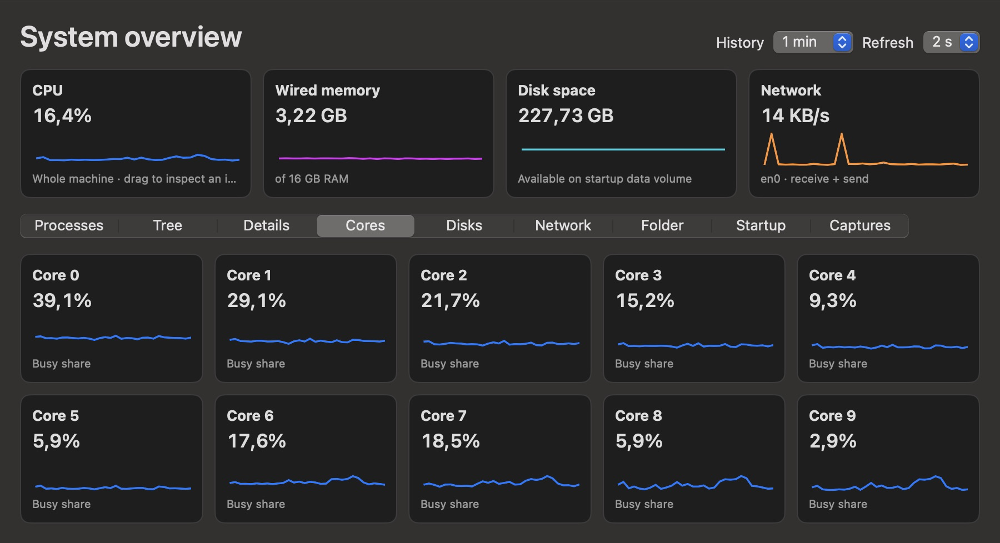

# Makarov Pulse for macOS

A native SwiftUI port of [Makarov Pulse for Windows](https://github.com/makarov-mm/pulse) by **Mykhailo Makarov**. The live resource graphs stay above the process list while you search, sort, or inspect a worker. The first release target is macOS 14 or later on Apple silicon and Intel.



## Why open Pulse alongside Activity Monitor?

| Question | Workflow in this foundation |
| --- | --- |
| What changed while I was looking at a process? | Keep the last minute of host CPU, wired memory, startup data-volume free space, and network activity in sight. Pause the display to read a row. |
| Which process instance am I inspecting? | Search by name or exact PID, then select a row. The inspector follows both PID and start time. When the executable is accessible, reveal it in Finder. |
| Is network activity on Wi-Fi, a tunnel, or another interface? | The Network card names the busiest measured interface. Switch to Network to compare receive and send rates for individual interface names. |

On macOS, host CPU use, process CPU use, wired memory, resident memory and disk capacity answer different questions. The table below gives their units. Apple's Activity Monitor guide describes how macOS distinguishes memory categories and pressure. [Apple’s memory guide](https://support.apple.com/guide/activity-monitor/actmntr1004/mac)

## Build and run on a Mac

Install Xcode 16 or later. The views rely on SwiftUI's main-actor isolation of `View` in that SDK. The app runs on macOS 14 or later. Open Terminal in the extracted directory and run the following commands.

```sh
swift test
sh scripts/build-app.sh
open "dist/Makarov Pulse.app"
```

The script builds for the current Mac's architecture and ad-hoc signs the local development bundle. Two environment variables change that:

| Variable | Effect |
| --- | --- |
| `PULSE_UNIVERSAL=1` | Build one binary for arm64 and x86_64. |
| `PULSE_SIGN_IDENTITY` | Sign with the named Developer ID identity, the hardened runtime and a secure timestamp. Notarize and staple the result yourself. |

For development, open `Package.swift` in Xcode and select the **MakarovPulse** executable scheme and **My Mac**. You can also run `swift run MakarovPulse`. The package has no external Swift dependencies. A GitHub Actions workflow runs the tests and builds the bundle on a macOS runner.

`sh scripts/load-worker.sh 20` burns one core for 20 seconds under the process name `yes`. Use it for the acceptance runs in the roadmap.

## Use the monitor

- Choose **Processes** for CPU load and resident memory. Choose **Details** for parent PID, numeric user ID and threads. Click a column heading to sort or reverse it.
- Press **⌘F** to focus the current table’s filter. Enter a name fragment, a PID, or an expression such as `pid: 1234`. Select a process for its inspector.
- Choose **Tree** for the parent/child view. Collapse a branch with its chevron. A filter keeps every ancestor of a matching process visible.
- Pick a 1-, 5- or 15-minute history in the toolbar. Drag across the CPU graph to rank the processes that were busiest in that interval, including ones that have already exited. The ranking shows PID, start time, average CPU and CPU time. It is built from the eight busiest processes of each sample.
- Select a process and choose **Pin timeline** to keep that instance's CPU graph above the table. The series is keyed by PID and start time, so a reused PID never continues it.
- Column widths, order and visibility, and the sort order, are stored separately for Processes and Details.
- Choose **Cores** for one graph per logical core.
- Choose **Disks** for cumulative bytes and read/write rates per storage device. Select a device to graph both directions. A device whose driver publishes no statistics shows —. These are transfer rates. The Disk space card stays a capacity reading.
- Choose **Network** to see measured interfaces that are up and non-loopback. The filter accepts interface names such as `en0`. Select an interface to graph its receive and send rates. A VPN tunnel and its underlying interface can both carry the same traffic.
- The inspector lists the selected instance's busiest threads, its open descriptors by kind, and its IPv4/IPv6 sockets with local and remote endpoints. It is a snapshot taken with each sample, so short-lived sockets can be missed, and processes of other users usually refuse inspection.
- **Quit App…** asks a regular app that you own to quit, after a confirmation. The app can ask to save changes or refuse. Pulse sends no signals.
- Choose **Startup** for a read-only list of launchd agents and daemons with their domain and program. Pulse does not load, edit or remove jobs. Login items are managed in System Settings.
- Choose **Folder**, then **Choose Folder…** to see where a folder's space went. The treemap and the list show the same entries. Click to select, double-click a folder to open it, and use the breadcrumb to go back. **On disk** counts allocated blocks and **File length** counts logical bytes. Symbolic links are not followed, other volumes and undownloaded cloud folders are not entered, and a hard-linked file is counted once. APFS clones share blocks, so On disk can exceed the space that deleting an entry would free. A warning marks totals that leave out unreadable locations.
- Choose **Captures** to export the retained history as a versioned JSON file, open a capture on any Mac, and rank an interval without live process access. **Compare With…** sets two runs side by side by process name and notes differing core counts, architectures and sampling intervals. Executable paths are saved only when you turn that on. Endpoint addresses are never saved.
- Choose a one-, two- or five-second refresh interval. **⇧⌘P** pauses or resumes updates. After resuming, the first sample establishes a new baseline.
- Choose **Makarov Pulse → About Makarov Pulse** for the version and developer credit. The English interface follows the system appearance and accent.

## Reading the numbers

| Reading | Meaning |
| --- | --- |
| CPU card | Busy CPU ticks as a percentage of total host ticks, from 0% to 100%. |
| Process CPU | CPU time consumed between observations. One fully occupied logical core gives about 100%. A multithreaded process can exceed it. |
| Wired memory | Wired pages multiplied by the system page size. The denominator is installed physical RAM. |
| Resident memory | Resident bytes reported for the task. Pages can be shared. Adding every row would count some pages more than once. |
| Disk space | Available capacity on the startup **data** volume. This card measures bytes of available space. Disk throughput is in the Disks view and folder sizes are in the Folder view. |
| Network | Change in cumulative 64-bit interface byte counters divided by elapsed time. The card uses the busiest readable interface’s combined rate. Its graph breaks when the selected interface changes. |
| — | A baseline is still forming, a counter reset, or the OS withheld a reading. Processes of other users are listed with their parent, owner and start time, and show — for CPU and memory. The status line shows how many listed processes were identified and how many have counters. |

## Project layout

| Path | Responsibility |
| --- | --- |
| `Sources/PulseCore/` | Process identity, sample deltas, search, bounded history with interval ranking, process tree, treemap layout, and the capture format. No platform imports. |
| `Sources/PulseMac/` | macOS collectors: processes, cores, interfaces, storage drivers, threads and sockets, the folder scanner and the launchd reader. One actor serializes OS reads away from the UI. |
| `Sources/DarwinHeaders/` | A module map and include-only header expose the installed SDK declarations to Swift. |
| `Sources/MakarovPulse/` | SwiftUI window, charts, tables, inspector, folder treemap, captures, AppKit About panel, and Finder integration. |
| `Tests/` | Deterministic model tests, and macOS tests that inspect the test process, a loopback socket and a folder fixture. |
| `Packaging/`, `scripts/` | Bundle metadata and local app packaging. |

**Build status.** The package builds with Xcode on macOS 27 (Apple silicon), and `swift test` passes: ten model tests and three native tests. The window was opened and its views were walked through once on that machine. The Folder and Captures file dialogs, the controlled acceptance runs in [ROADMAP.md](ROADMAP.md), an Intel build and the minimum macOS 14 release are still open.
